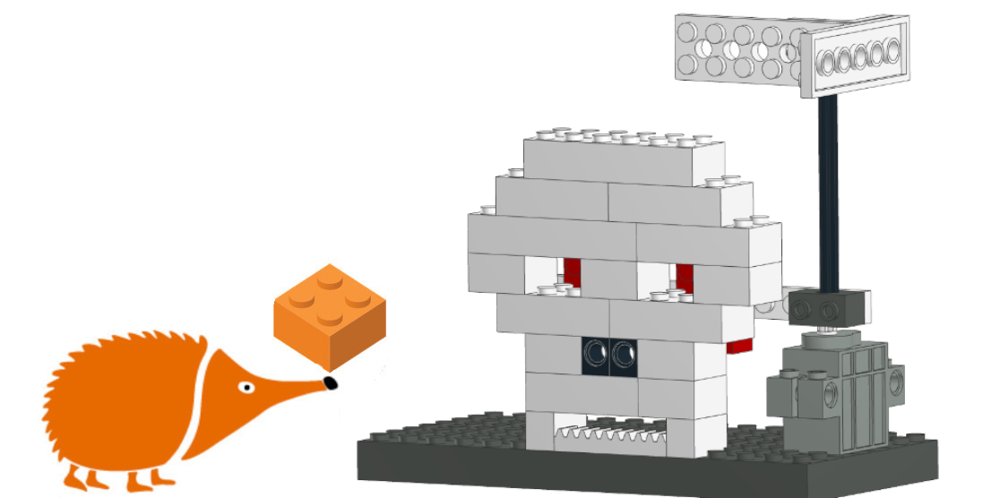
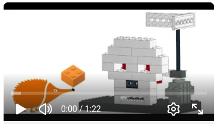
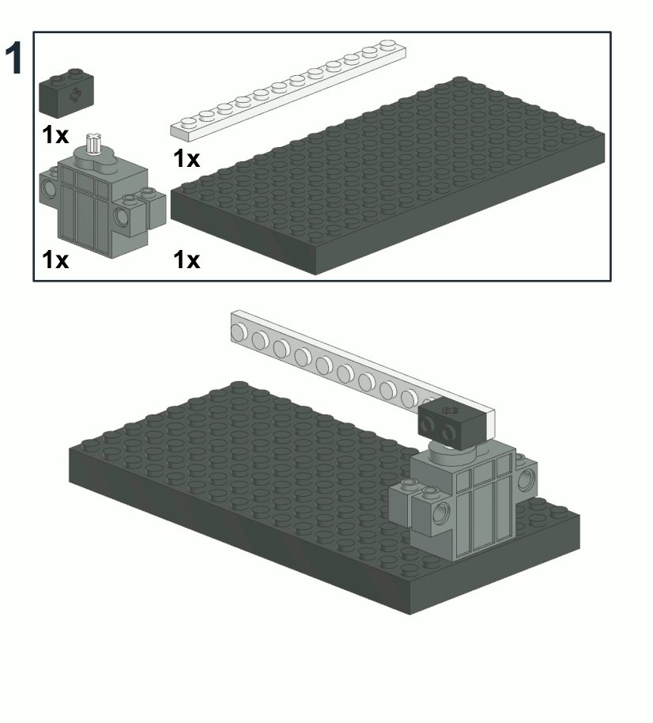
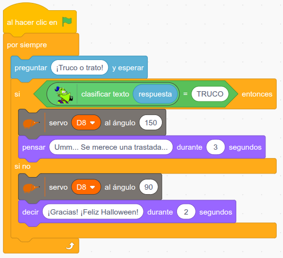

# Calavera

En este proyecto de Halloween, una calavera de bloques de construcción controlada por la placa EchidnaBlack2 decide, cuando llamamos a una casa para hacer "Truco o Trato", si aceptamos su trato o le damos un buen susto. Mediante un modelo de texto entrenado en LearningML, se detecta si la respuesta a la pregunta "¿Truco o trato?" es amable o si, por el contrario, se merece un susto.

Si la respuesta es amable, el cartel superior muestra "Trato". Si no lo es, el servomotor gira el cartel a la posición de "Truco" y los ojos de la calavera se ponen rojos, gracias a que el mismo giro coloca unos bloques de construcción rojos justo detrás de los huecos de los ojos.

## Vídeo

## Guía de montaje

[Instrucciones en PDF](calavera.pdf)

[Lista de piezas (CSV)](calavera.csv)

## Modelo de LearningML

El modelo de texto distingue entre dos clases, TRUCO y TRATO, a partir de ejemplos de respuestas amables y poco amables. Se aporta este modelo, pero puede mejorarse considerablemente...

[Descarga los datos de entrenamiento para LearningML](truco-o-trato.json)

## Proyecto en EchidnaML

[Descarga el archivo .sb3 para EchidnaML](calavera.sb3)

[Fondo de la puerta de Halloween (SVG)](puerta-halloween.svg)
