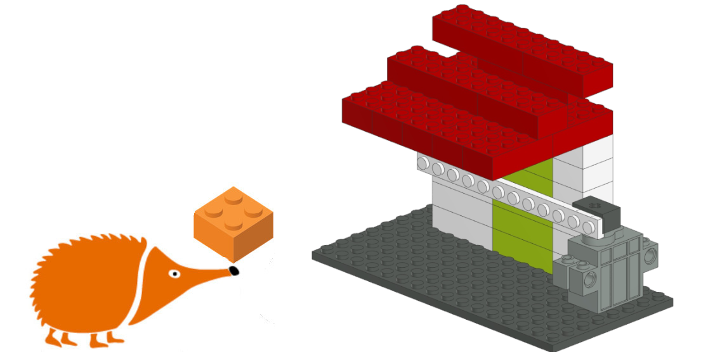
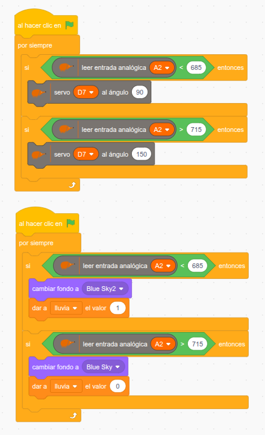
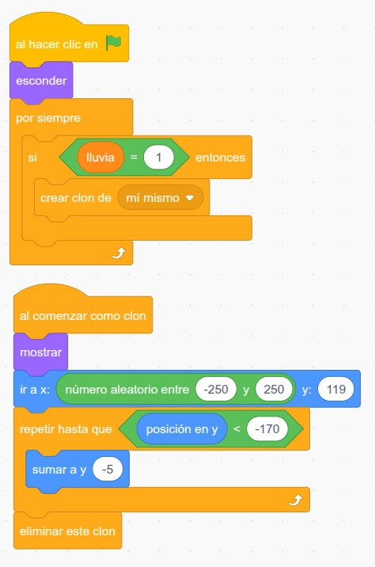
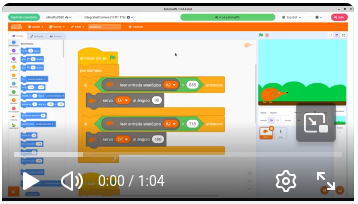

# Tendedero

En este proyecto adapto una idea que se ha visto en numerosas publicaciones en redes, cuyo proyecto original no he logrado encontrar. En este tendedero automático, un servomotor controlado por la placa EchidnaBlack2 recoge la ropa bajo el tejadillo cuando llueve para que no se moje.
El sensor de humedad conectado a la entrada analógica A2 detecta el agua, y cuando su lectura baja del valor de umbral definido (en este caso 685), el servomotor conectado a D7 gira a 90º y mete el tendedero bajo el tejado; cuando vuelve a superar 715, el servomotor gira a 150º y saca de nuevo el tendedero. La diferencia entre los dos umbrales evita que el tendedero se mueva continuamente cuando la lectura está en el límite.

Como posibilidad de ampliación, el estado del sensor se refleja también en la pantalla de EchidnaML: cuando llueve cambia el fondo y empiezan a caer gotas, conectando el modelo físico con su representación virtual.

## Guía de montaje

- [Gif animado con las instrucciones paso a paso](tendedero.gif)

- [Instrucciones en PDF](tendedero.pdf)

- [Archivo CAD montaje](tendedero.ldr)

- [Lista de piezas](tendedero.csv)

## Proyecto en EchidnaML

- [Descarga el archivo .sb3 para EchidnaML](tendedero.sb3)

Programa principal: control del tendedero según la lectura del sensor de humedad.

Ampliación: gotas de lluvia en pantalla mientras llueve.

## Vídeo

